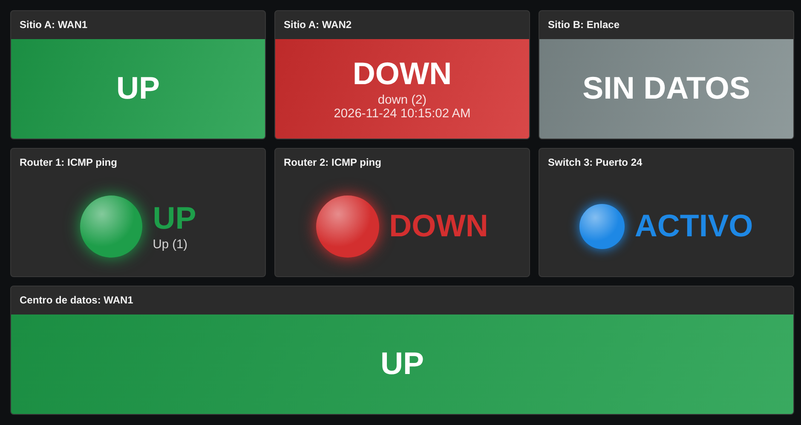

# Semáforo UP/DOWN

Widget de dashboard para **Zabbix 7.0** que muestra el estado de un ítem como un semáforo:
verde cuando está arriba, rojo cuando está abajo y gris cuando no hay datos.
Sirve para cualquier ítem de tipo "arriba/abajo": ping ICMP, estado de interfaz SNMP (`ifOperStatus`),
estado de un servicio, de un enlace WAN, de un túnel, etc.



## Requisitos

- Zabbix 7.0 (frontend con `manifest_version` 2.0). No funciona en 6.0.
- PHP 8.0 o superior (el que ya usa el frontend de Zabbix).

## Instalación

1. Copia la carpeta `status_light` a la carpeta de módulos del frontend.
   En los paquetes oficiales es `/usr/share/zabbix/modules/`:

   ```bash
   # Copia el widget dentro de la carpeta de módulos de Zabbix
   cp -r status_light /usr/share/zabbix/modules/

   # Deja los archivos con el mismo dueño que el resto del frontend (en paquetes RHEL/CentOS es root)
   chown -R root:root /usr/share/zabbix/modules/status_light
   ```

2. En Zabbix: **Administration › General › Modules › Scan directory**.
3. Busca **Semáforo UP/DOWN**, márcalo y pulsa **Enable**.
4. En un dashboard: **Edit dashboard › Add widget › Semáforo UP/DOWN**.

## Configuración

| Campo | Qué hace | Valor por defecto |
|---|---|---|
| **Ítem** | El ítem a vigilar. Acepta numéricos, texto, carácter y log. | (obligatorio) |
| **Override host** | Usa el ítem con la misma clave en otro host (o el host que elijas en el dashboard). | vacío |
| **Valores UP** | Lista separada por comas. Si el último valor coincide con alguno, el semáforo va en verde. | `1` |
| **Valores DOWN** | Lista separada por comas. Si está vacía, **todo lo que no sea UP es DOWN**. Si la llenas, lo que no coincida con ninguna lista sale como "sin datos". | vacío |
| **Estilo** | *Fondo completo* pinta todo el widget. *Círculo* dibuja una luz con el texto al lado. | Fondo completo |
| **Tamaño del círculo (%)** | Diámetro de la luz, en % del lado más corto del widget. Solo con estilo *Círculo*. | 70 |
| **Tamaño del texto (%)** | Alto del texto de estado, en % del alto del widget. | 35 |
| **Mostrar** | Qué texto aparece: *Estado* (UP/DOWN), *Valor* (el dato real, con su mapeo de valores) y *Hora del dato*. | Estado |
| **Textos UP / DOWN / sin datos** | Lo que se escribe en cada estado. Por ejemplo `ARRIBA`, `CAÍDO`, `ACTIVO`. | `UP`, `DOWN`, `SIN DATOS` |
| **Colores UP / DOWN / sin datos** | Color de cada estado. | verde `1E9E4A`, rojo `D32F2F`, gris `7F8C8D` |
| **Color del texto** | Color del texto en el estilo *Fondo completo*. | blanco |
| **Sin datos después de (min)** | Si el último dato es más viejo que esto, se muestra como "sin datos". `0` lo desactiva. | 0 |
| **Parpadear en DOWN** | Hace parpadear el indicador cuando está en DOWN. | apagado |

El tamaño del widget se cambia como cualquier otro: arrastrando su esquina en modo edición.
El texto y la luz se ajustan solos al tamaño.

Al hacer clic en el semáforo se abre el historial del ítem (gráfica si es numérico, valores si es texto).

### Cómo decide el color

1. Si no hay ningún dato (o el dato es más viejo que *Sin datos después de*): **sin datos**.
2. Si el valor está en *Valores UP*: **UP**.
3. Si *Valores DOWN* está vacío, o el valor está en esa lista: **DOWN**.
4. En otro caso: **sin datos**.

Las comparaciones aceptan el valor crudo **o** el texto de su mapeo de valores (value mapping),
sin distinguir mayúsculas. Los números se comparan como número (`1` es igual a `1.0000`).

### Ejemplos

| Ítem | Valores UP | Valores DOWN |
|---|---|---|
| Ping ICMP (`icmpping`) | `1` | vacío |
| Interfaz SNMP (`ifOperStatus`, 1 = up, 2 = down) | `1` | vacío, o `2` si quieres ver los demás estados en gris |
| Servicio con texto `running` / `stopped` | `running` | vacío |
| Ítem con mapeo de valores `Up` / `Down` | `up` | `down` |

## Archivos

```
status_light/
├── manifest.json            Datos del módulo para Zabbix
├── Widget.php               Clase del widget y constantes
├── includes/WidgetForm.php  Campos del formulario y su validación
├── actions/WidgetView.php   Lee el último valor y decide el estado
├── views/widget.edit.php    Formulario de configuración
├── views/widget.edit.js.php Selectores de color del formulario
├── views/widget.view.php    Dibujo del semáforo
└── assets/                  CSS y JavaScript
```

## Licencia

MIT, ver [LICENSE](../LICENSE).
